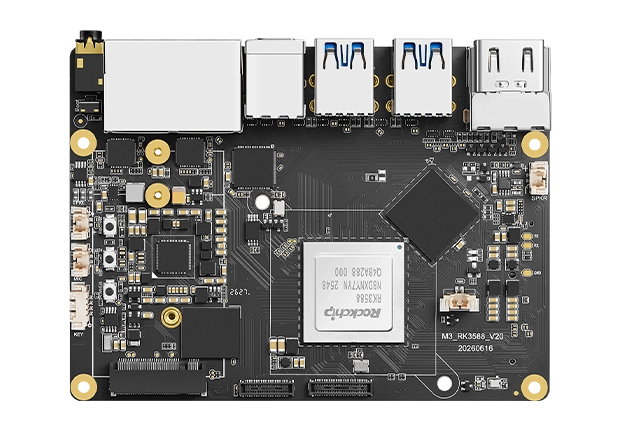
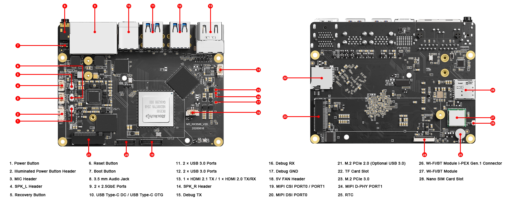

# KiwiPi 5 Pro

Official documentation, downloads and developer resources for KiwiPi 5 Pro, a Rockchip RK3588 single-board computer.

[KiwiPi website](https://kiwipi.com/) · [Product page](https://kiwipi.com/product/kiwi-pi-5pro/) · [Documentation center](https://kiwipi.com/document-center/?dc_tab=6896.1) · [Contact KiwiPi](https://kiwipi.com/contact-us/)

## Technical configuration

| Component | Configuration |
| --- | --- |
| SoC | Rockchip RK3588, 8 nm |
| CPU | 4 × Cortex-A76 at 2.2 GHz + 4 × Cortex-A55 at 1.8 GHz |
| GPU | Arm Mali-G610 MC4 |
| NPU | Up to 6 TOPS |
| RAM | 8 GB LPDDR4X; optional 4 / 16 / 32 GB configurations |
| Onboard storage | 64 GB; optional 128 / 256 / 512 GB configurations |
| Storage expansion | PCIe 3.0 ×4 M.2 2280 SSD and microSD |
| USB | USB-C OTG with DisplayPort Alt Mode, 4 × USB 3.0 host |
| HDMI | HDMI 2.1 output; additional HDMI 2.0 interface as listed on the product page |
| Ethernet | 2 × 2.5 Gigabit RJ45 |
| Wireless | Wi-Fi 6, Bluetooth 5.4 BLE |
| Mobile connectivity | M.2 module support and nano-SIM interface; module required |
| Display and camera expansion | MIPI-DSI and 2 × 4-lane MIPI-CSI; see the hardware manual |
| Audio | 3.5 mm headset jack, onboard microphone and stereo speaker interface |
| RTC | Rechargeable button battery support |
| Cooling | 5 V fan connector |
| Power input | USB-C PD; follow the hardware manual for your board revision |
| Official OS downloads | Android 15, Ubuntu 24.04, Debian 12 |

Configuration options are listed on the [official product page](https://kiwipi.com/product/kiwi-pi-5pro/); availability depends on the ordered variant. Refer to the matching hardware manual for connector functions, pinouts and electrical limits.

## Board layout

Images: [official KiwiPi 5 Pro product page](https://kiwipi.com/product/kiwi-pi-5pro/).

## Start here

1. Identify your board model and hardware revision.
2. Read the [official user manuals](https://drive.google.com/drive/folders/1txRkogPIWy0VG9KGqm2bTIBfw65wT7H0).
3. Choose an image from [Downloads](docs/downloads.md).
4. Follow its firmware installation instructions.

Use the designated power and data connectors described in your board manual. Back up storage before flashing.

## Documentation

- [Downloads and developer resources](docs/downloads.md)
- [Documentation guide](docs/documentation.md)
- [Official product specifications](https://kiwipi.com/product/kiwi-pi-5pro/)

## Support

[Contact KiwiPi](https://kiwipi.com/contact-us/) for product inquiries and help selecting resources for your board.

Third-party tools and Rockchip materials retain their respective authors' terms. Source archives may contain components under different licenses.
